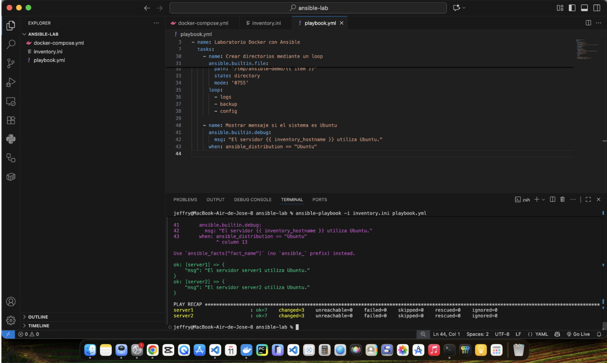

# Laboratorio Docker y Ansible — ITLA

**Estudiante:** Jeffrey Mercado  
**Matrícula:** 2022-0443  
**Materia:** Electiva 1 — DevOps

## Objetivo

Crear un laboratorio con dos servidores Linux Ubuntu 24.04 mediante Docker y administrarlos de forma automatizada utilizando Ansible.

## Estructura del proyecto

- `docker-compose.yml`: define los contenedores Ubuntu `server1` y `server2`.
- `inventory.ini`: identifica los servidores que Ansible administra mediante la conexión Docker.
- `playbook.yml`: contiene las tareas automatizadas que se ejecutan en ambos servidores.
- `README.md`: documenta la instalación, ejecución y resultados del laboratorio.

## Iniciar los servidores

Desde la carpeta del proyecto, ejecutar:

```bash
docker compose up -d
```

Comprobar que están activos:

```bash
docker ps
```

Cada contenedor debe tener Python 3 instalado para ejecutar los módulos de Ansible.

## Verificar la conexión

```bash
ansible docker -i inventory.ini -m ping
```

Ambos servidores deben responder con `SUCCESS` y `pong`.

## Ejecutar el playbook

```bash
ansible-playbook -i inventory.ini playbook.yml
```

## Funciones del playbook

El playbook realiza las siguientes operaciones en ambos servidores:

1. Muestra el nombre del servidor.
2. Identifica el sistema operativo.
3. Crea el directorio `/tmp/ansible-demo`.
4. Genera el archivo `info.txt` con los datos del servidor.
5. Crea las carpetas `logs`, `backup` y `config` mediante un bucle.
6. Muestra un mensaje cuando el sistema operativo es Ubuntu.

## Resultados obtenidos

La ejecución terminó correctamente en ambos servidores:

| Servidor | OK | Cambios | Errores |
|---|---:|---:|---:|
| server1 | 7 | 3 | 0 |
| server2 | 7 | 3 | 0 |

## Evidencia de ejecución

La siguiente captura muestra la ejecución exitosa de Ansible en ambos servidores, sin errores.



## Conclusión

Esta práctica permitió comprender cómo Docker facilita la creación de entornos Linux y cómo Ansible automatiza tareas de administración en varios servidores. La ejecución del playbook demuestra que es posible realizar configuraciones de manera uniforme, reduciendo el trabajo manual y los errores.